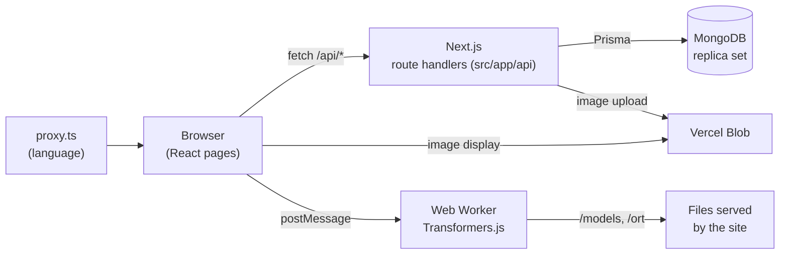
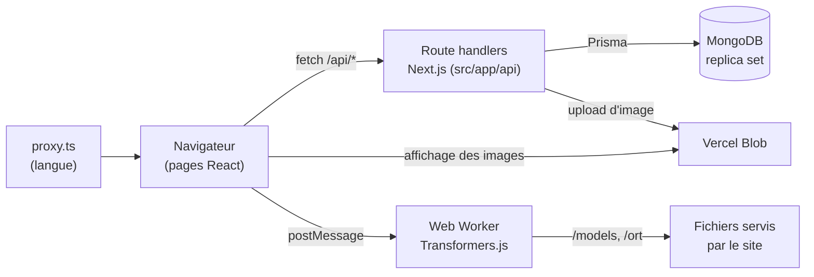

<p align="center">
  <a href="#english"><b>🇬🇧 English</b></a> · <a href="#francais"><b>🇫🇷 Français</b></a>
</p>

<a id="english"></a>

<p align="center">
  
</p>

<h1 align="center">Pattes Douces</h1>

<p align="center">
  <strong>The community blog for furballs</strong><br>
  Cats, dogs, rabbits… publish your articles, react to and comment on other people's, track your statistics.
</p>

<p align="center">
  <a href="https://github.com/Alexandre-git-SDV/Projet-Blog-Pattes-Douces/actions/workflows/build.yml"></a>
  
  
  
  
  
  
  
  
  
</p>

---

## Table of contents

- [About](#about)
- [Features](#features)
- [Languages and accessibility](#languages-and-accessibility)
- [Tech stack](#tech-stack)
- [Local installation](#local-installation)
  - [Prerequisites](#prerequisites)
  - [Option A: with pnpm](#option-a-with-pnpm)
  - [Option B: everything in Docker](#option-b-everything-in-docker)
  - [Environment variables](#environment-variables)
- [Available scripts](#available-scripts)
- [Architecture](#architecture)
- [Security and privacy](#security-and-privacy)
- [Troubleshooting](#troubleshooting)
- [Quality and CI](#quality-and-ci)
- [License](#license)

---

## About

**Pattes Douces** is a community blog where pets (with a little help from
their humans) write. Every member can publish articles, react (like /
dislike) to and comment on other members' articles, then follow the audience
of their posts from a statistics page.

The application is built with **Next.js 16** (App Router): the interface and
the REST API live in the same project, data is stored in **MongoDB** through
the **Prisma** ORM, and article images are hosted on **Vercel Blob**. The
interface is available in **4 languages** and designed to meet **RGAA 4.1.2 /
WCAG 2.2 level AA**.

> The application code lives in [`blog-pattes-douces/`](blog-pattes-douces/).
> The detailed technical reference (API, data model, i18n, version constraints)
> is in [`blog-pattes-douces/README.md`](blog-pattes-douces/README.md) (in French),
> and the design system in [`DESIGN.md`](DESIGN.md) (in French).

## Features

Every page is available under its language prefix, e.g. `/en/feed` or `/fr/feed`.

| | Feature | Page |
|---|---|---|
| 🔐 | **Sign up and log in**: strong password, species (cat, dog, rabbit…), automatic login after sign-up | `/register`, `/login` |
| 📰 | **News feed** with a welcome banner for visitors and a **search** on title, text and author | `/`, `/feed` |
| 📖 | **Reading an article**: views, likes / dislikes, comments | `/articles/[id]` |
| 🌐 | **Translation of articles and comments** into the interface language, computed locally in the browser | `/articles/[id]` |
| ✍️ | **Publishing** an article, with an optional image | `/articles/new` |
| 🗂️ | **My articles**: list and deletion with confirmation | `/my-articles` |
| 📊 | **Statistics**: tiles, reactions donut, bars and per-article table | `/dashboard` |
| 🕘 | **Activity**: my comments and the articles I liked | `/activity`, `/comments` |
| 👤 | **Profile**: species, bio, summary, log out, account deletion | `/profile` |
| ℹ️ | **About, Contact, Privacy, Accessibility statement** | `/about`, `/contact`, `/privacy`, `/accessibility` |

Pages reserved for members redirect visitors to the login page, then bring
them back to the page they asked for.

## Languages and accessibility

- **4 languages**: French (default), English, Arabic (right-to-left) and
  Chinese. The language is part of the URL; a visitor without one is sent to
  their last choice, otherwise to their browser language.
- **Light and dark themes**, remembered, applied before the first paint.
- **Accessibility** (RGAA 4.1.2 / WCAG 2.2 AA): skip link, landmarks,
  visible focus, keyboard-only navigation, 44 px targets, status messages
  announced to screen readers, confirmation dialogs, forms with linked errors.
  The site is declared **partially compliant** until a full audit is done
  (see `/accessibility`).
- **Content translation**: the [Transformers.js](https://huggingface.co/docs/transformers.js)
  library runs Opus-MT models in a Web Worker. Models are served by the site
  itself: the text never leaves the device and no third-party service is called.

## Tech stack

| Area | Technology |
|---|---|
| Framework | [Next.js 16](https://nextjs.org) — App Router, Turbopack, route handlers, `proxy.ts` |
| Interface | [React 19](https://react.dev), [Tailwind CSS 4](https://tailwindcss.com), line icons (inline SVG) |
| Languages | Locale routing `app/[lang]`, JSON messages per namespace, CLDR plurals (`Intl.PluralRules`) |
| Translation | [Transformers.js](https://huggingface.co/docs/transformers.js) + [Opus-MT](https://huggingface.co/Helsinki-NLP) models (ONNX, WebAssembly) |
| Database | [MongoDB 8.0](https://www.mongodb.com) (replica set) via [Prisma 6](https://www.prisma.io) |
| Images | [Vercel Blob](https://vercel.com/docs/storage/vercel-blob) |
| Language | TypeScript 6 (strict mode) |
| Tooling | pnpm 10, ESLint 10, [Vitest 5](https://vitest.dev), Docker / Docker Compose, GitHub Actions |

## Local installation

Two methods to choose from:

| | Option A: pnpm | Option B: Docker |
|---|---|---|
| **Who it's for** | Developing (hot reload) | Running the application with nothing but Docker installed |
| **Application** | `pnpm dev` on your machine | Container (production build) |
| **MongoDB database** | Docker container or MongoDB Atlas | Docker container |

### Prerequisites

| Tool | Version | Option A | Option B | Check |
|---|---|:---:|:---:|---|
| [Git](https://git-scm.com) | recent | ✅ | ✅ | `git --version` |
| [Docker](https://docs.docker.com/get-docker/) + Compose | recent | ✅ ¹ | ✅ | `docker compose version` |
| [Node.js](https://nodejs.org) | 24 LTS | ✅ | — | `node -v` |
| [pnpm](https://pnpm.io) | 10 | ✅ | — | `pnpm -v` |

¹ For the local database only; not needed with a [MongoDB Atlas](https://www.mongodb.com/atlas) database.
pnpm is installed with `corepack enable` (bundled with Node.js), which
automatically uses the version pinned in `package.json`.

To start, get the project:

```bash
git clone https://github.com/Alexandre-git-SDV/Projet-Blog-Pattes-Douces.git
cd Projet-Blog-Pattes-Douces/blog-pattes-douces
cp .env.example .env
```

### Option A: with pnpm

```bash
pnpm install              # 1. dependencies (also generates the Prisma client)
pnpm db:up                # 2. starts MongoDB as a replica set (Docker) and waits until it is ready
pnpm db:push              # 3. creates the database indexes (unique username and email)
pnpm translation:setup    # 4. translation models (~680 MB, once) — optional, see below
pnpm dev                  # 5. development server
```

The application is available at **http://localhost:3000** (redirected to
`/fr`, `/en`, `/ar` or `/zh`). To stop the database: `pnpm db:down` (data is kept).

> **Step 4** downloads the 6 translation models into `public/models` and copies
> the ONNX runtime into `public/ort` (both ignored by git). Without it,
> everything works except the "Translate to…" button on articles and comments.

> **With MongoDB Atlas** instead of Docker: skip step 2 and replace
> `DATABASE_URL` in `.env` with the Atlas connection string (already a replica set).

### Option B: everything in Docker

```bash
docker compose --profile app up -d --build --wait    # or: pnpm docker:up
```

This command builds the application image, then starts three services:

| Service | Role |
|---|---|
| `mongo` | MongoDB 8.0 as a replica set, data persisted in a volume |
| `db-init` | Creates the database indexes, then exits |
| `app` | The application (Next.js production build), on **http://localhost:3000** |

The image build prepares the translation models in a cached stage: the first
build downloads them (~680 MB), the following ones reuse them.
`--wait` returns once the application responds. To stop everything:
`docker compose --profile app down` (add `-v` to also erase the data).

### Environment variables

They are defined in `.env` (copied from [`.env.example`](blog-pattes-douces/.env.example)).
**This file is never committed**: it is ignored by git.

| Variable | Required | Description |
|---|---|---|
| `DATABASE_URL` | Option A | MongoDB connection. The default value points to the local Docker database. In option B, `compose.yaml` provides it to the application. |
| `BLOB_READ_WRITE_TOKEN` | For images | Vercel Blob token (*Storage > Blob > Tokens*). Without it, everything works except adding an image to an article. |

Ports already in use? Prefix the Docker commands with `MONGO_PORT=27019`
and/or `APP_PORT=3005` (then remember to adapt `DATABASE_URL` in option A).

## Available scripts

To run from `blog-pattes-douces/`:

| Command | Effect |
|---|---|
| `pnpm dev` | Development server with hot reload |
| `pnpm build` / `pnpm start` | Production build / start the build |
| `pnpm lint` | ESLint analysis |
| `pnpm typecheck` | TypeScript check (route types included) |
| `pnpm test` / `pnpm test:watch` | Unit tests (Vitest), once / in watch mode |
| `pnpm translation:setup` | Downloads the translation models and copies the ONNX runtime into `public/` |
| `pnpm db:up` / `pnpm db:down` | Start / stop MongoDB (Docker) |
| `pnpm db:push` | Sync the database indexes with the Prisma schema |
| `pnpm docker:up` / `pnpm docker:down` | Start / stop the whole application in Docker |

## Architecture



```
blog-pattes-douces/
├── prisma/schema.prisma    Data model (User, Article, Commentaire)
├── public/                 Logo, flags; models/ and ort/ installed by translation:setup
├── scripts/                translation-assets.mjs (translation models and runtime)
├── src/
│   ├── app/[lang]/         Pages and root layout, one version per language
│   ├── app/api/            REST API (route handlers)
│   ├── components/         ui/ (buttons, fields, dialogs…), layout/ (shell), icons/
│   ├── features/           Business code per feature (auth, articles, translation…)
│   ├── i18n/               Languages, JSON messages, plurals, localized navigation
│   ├── theme/              Light / dark theme
│   ├── lib/                Prisma, validation, API client, routes, session
│   └── proxy.ts            Language negotiation and legacy URL redirects
├── compose.yaml            MongoDB + application (Docker)
└── Dockerfile              Production image
```

The pages in `src/app/` remain simple entry points (Server Components);
all interactive logic lives in `src/features/`. API routes, the data model and
the i18n are detailed in the [technical reference](blog-pattes-douces/README.md)
(in French), the interface rules in [`DESIGN.md`](DESIGN.md) (in French).

## Security and privacy

- API responses never expose the password hash or the email.
- All inputs are validated on the server; an invalid input returns 400 or 404.
- Login does not reveal whether a username exists.
- Uploads are limited to images (JPEG, PNG, WebP, GIF) of 4 MB maximum.
- Security HTTP headers, secrets kept out of the repository, monitored dependencies.
- Content translation runs in the browser with self-hosted models: no text is
  sent to a translation service.

> [!WARNING]
> **Known limitation:** the user's identity is kept in the browser
> (`localStorage`) and is not verified by the server. A real session
> (`httpOnly` cookie) is required before any production deployment. Details in the
> [technical reference](blog-pattes-douces/README.md#sécurité) (in French).

## Troubleshooting

<details>
<summary><b>"Prisma needs to perform transactions, which requires your MongoDB server to be run as a replica set"</b></summary>

`DATABASE_URL` points to a MongoDB started without a replica set. Use
`pnpm db:up` and the URL provided in `.env.example`, or an Atlas database.
</details>

<details>
<summary><b>Articles do not load ("The content could not be loaded")</b></summary>

The database is not running (for example after a reboot). Start it with
`pnpm db:up`, then click "Try again".
</details>

<details>
<summary><b>"Translation failed. Please try again."</b></summary>

The translation models are missing: run `pnpm translation:setup` once, then
reload the page. The first translation of a language pair loads its model
(a few seconds); the next ones are immediate.
</details>

<details>
<summary><b>Port 27017 or 3000 is already in use</b></summary>

Another service is using the port. For example, run
`MONGO_PORT=27019 pnpm db:up` and put `localhost:27019` in `DATABASE_URL`,
or `APP_PORT=3005 pnpm docker:up` for the application.
</details>

<details>
<summary><b>"Image upload is not configured" when publishing</b></summary>

Set `BLOB_READ_WRITE_TOKEN` in `.env`, then restart
(`pnpm dev`, or `pnpm docker:up` in option B), or publish without an image.
</details>

<details>
<summary><b>"Another next dev server is already running"</b></summary>

A `pnpm dev` is already running in this folder: use the URL it prints or
stop it before starting another one.
</details>

<details>
<summary><b>I forgot <code>pnpm db:push</code></b></summary>

The application works, but the database no longer guarantees unique usernames
and emails. Run it after every database creation.
</details>

## Quality and CI

Every push and pull request to `main` or `development` triggers:

| Workflow | Checks |
|---|---|
| **Build** | Install, Prisma schema, ESLint, unit tests (Vitest), TypeScript, Next.js build, Docker image build |
| **CodeQL** | Security analysis of the JavaScript / TypeScript code and workflows |
| **Actions & CI Files** | Workflow lint (actionlint) and security audit (zizmor) |

The unit tests cover the i18n (plurals, language negotiation, parity of the
4 message files), validation, routes, the language proxy and the translation
module. [Dependabot](.github/dependabot.yml) proposes weekly updates for npm
dependencies, GitHub Actions and the Docker image, with a 7-day delay after
each release.

## License

This project is distributed under the **MIT** license. The Opus-MT translation
models (Helsinki-NLP) are distributed under the Apache-2.0 license.

---

<p align="center">
  <a href="#english"><b>🇬🇧 English</b></a> · <a href="#francais"><b>🇫🇷 Français</b></a>
</p>

<a id="francais"></a>

<p align="center">
  
</p>

<h1 align="center">Pattes Douces</h1>

<p align="center">
  <strong>Le blog des boules de poils</strong><br>
  Chats, chiens, lapins… publiez vos articles, réagissez et commentez ceux des autres, suivez vos statistiques.
</p>

<p align="center">
  <a href="https://github.com/Alexandre-git-SDV/Projet-Blog-Pattes-Douces/actions/workflows/build.yml"></a>
  
  
  
  
  
  
  
  
  
</p>

---

## Sommaire

- [À propos](#à-propos)
- [Fonctionnalités](#fonctionnalités)
- [Langues et accessibilité](#langues-et-accessibilité)
- [Stack technique](#stack-technique)
- [Installation locale](#installation-locale)
  - [Prérequis](#prérequis)
  - [Option A : avec pnpm](#option-a--avec-pnpm)
  - [Option B : tout dans Docker](#option-b--tout-dans-docker)
  - [Variables d'environnement](#variables-denvironnement)
- [Scripts disponibles](#scripts-disponibles)
- [Architecture](#architecture-1)
- [Sécurité et confidentialité](#sécurité-et-confidentialité)
- [Dépannage](#dépannage)
- [Qualité et CI](#qualité-et-ci)
- [Licence](#licence)

---

## À propos

**Pattes Douces** est un blog communautaire où ce sont les animaux (avec un
peu d'aide de leurs humains) qui écrivent. Chaque membre peut publier des
articles, réagir (j'aime / je n'aime pas) et commenter ceux des autres, puis
suivre l'audience de ses publications depuis une page de statistiques.

L'application est construite avec **Next.js 16** (App Router) : l'interface et
l'API REST vivent dans le même projet, les données sont stockées dans
**MongoDB** via l'ORM **Prisma**, et les images d'articles sont hébergées sur
**Vercel Blob**. L'interface est disponible en **4 langues** et conçue pour
respecter le **RGAA 4.1.2 / WCAG 2.2 niveau AA**.

> Le code de l'application se trouve dans [`blog-pattes-douces/`](blog-pattes-douces/).
> La référence technique détaillée (API, modèle de données, i18n, contraintes
> de versions) est dans [`blog-pattes-douces/README.md`](blog-pattes-douces/README.md),
> et le système de design dans [`DESIGN.md`](DESIGN.md).

## Fonctionnalités

Chaque page existe sous le préfixe de sa langue, par exemple `/fr/feed` ou `/en/feed`.

| | Fonctionnalité | Page |
|---|---|---|
| 🔐 | **Inscription et connexion** : mot de passe fort, espèce (chat, chien, lapine…), connexion automatique après l'inscription | `/register`, `/login` |
| 📰 | **Fil d'actualité** avec bandeau d'accueil pour les visiteurs et **recherche** sur le titre, le texte et l'auteur | `/`, `/feed` |
| 📖 | **Lecture d'un article** : vues, j'aime / je n'aime pas, commentaires | `/articles/[id]` |
| 🌐 | **Traduction des articles et commentaires** dans la langue de l'interface, calculée dans le navigateur | `/articles/[id]` |
| ✍️ | **Publication** d'un article, avec image facultative | `/articles/new` |
| 🗂️ | **Mes articles** : liste et suppression avec confirmation | `/my-articles` |
| 📊 | **Statistiques** : tuiles, anneau des réactions, barres et tableau par article | `/dashboard` |
| 🕘 | **Activité** : mes commentaires et les articles que j'aime | `/activity`, `/comments` |
| 👤 | **Profil** : espèce, biographie, résumé, déconnexion, suppression du compte | `/profile` |
| ℹ️ | **À propos, Contact, Confidentialité, Déclaration d'accessibilité** | `/about`, `/contact`, `/privacy`, `/accessibility` |

Les pages réservées aux membres renvoient un visiteur vers la connexion, puis
le ramènent sur la page demandée.

## Langues et accessibilité

- **4 langues** : français (par défaut), anglais, arabe (de droite à gauche)
  et chinois. La langue fait partie de l'URL ; sans langue, le visiteur est
  envoyé vers son dernier choix, sinon vers la langue de son navigateur.
- **Thèmes clair et sombre**, mémorisés, appliqués avant le premier affichage.
- **Accessibilité** (RGAA 4.1.2 / WCAG 2.2 AA) : lien d'évitement, landmarks,
  focus visible, navigation au clavier seul, cibles de 44 px, messages de
  statut annoncés aux lecteurs d'écran, dialogues de confirmation, formulaires
  aux erreurs reliées. Le site est déclaré **partiellement conforme** tant
  qu'un audit complet n'est pas fait (voir `/accessibility`).
- **Traduction des contenus** : la librairie [Transformers.js](https://huggingface.co/docs/transformers.js)
  exécute des modèles Opus-MT dans un Web Worker. Les modèles sont servis par
  le site lui-même : le texte ne quitte pas l'appareil et aucun service tiers
  n'est appelé.

## Stack technique

| Domaine | Technologie |
|---|---|
| Framework | [Next.js 16](https://nextjs.org) — App Router, Turbopack, route handlers, `proxy.ts` |
| Interface | [React 19](https://react.dev), [Tailwind CSS 4](https://tailwindcss.com), icônes au trait (SVG en ligne) |
| Langues | Routage `app/[lang]`, messages JSON par espace de noms, pluriels CLDR (`Intl.PluralRules`) |
| Traduction | [Transformers.js](https://huggingface.co/docs/transformers.js) + modèles [Opus-MT](https://huggingface.co/Helsinki-NLP) (ONNX, WebAssembly) |
| Base de données | [MongoDB 8.0](https://www.mongodb.com) (replica set) via [Prisma 6](https://www.prisma.io) |
| Images | [Vercel Blob](https://vercel.com/docs/storage/vercel-blob) |
| Langage | TypeScript 6 (mode strict) |
| Outillage | pnpm 10, ESLint 10, [Vitest 5](https://vitest.dev), Docker / Docker Compose, GitHub Actions |

## Installation locale

Deux méthodes au choix :

| | Option A : pnpm | Option B : Docker |
|---|---|---|
| **Pour qui** | Développer (rechargement à chaud) | Lancer l'application sans rien installer d'autre que Docker |
| **Application** | `pnpm dev` sur votre machine | Conteneur (build de production) |
| **Base MongoDB** | Conteneur Docker ou MongoDB Atlas | Conteneur Docker |

### Prérequis

| Outil | Version | Option A | Option B | Vérifier |
|---|---|:---:|:---:|---|
| [Git](https://git-scm.com) | récente | ✅ | ✅ | `git --version` |
| [Docker](https://docs.docker.com/get-docker/) + Compose | récente | ✅ ¹ | ✅ | `docker compose version` |
| [Node.js](https://nodejs.org) | 24 LTS | ✅ | — | `node -v` |
| [pnpm](https://pnpm.io) | 10 | ✅ | — | `pnpm -v` |

¹ Pour la base locale uniquement ; inutile avec une base [MongoDB Atlas](https://www.mongodb.com/atlas).
pnpm s'installe avec `corepack enable` (fourni avec Node.js), qui utilise
automatiquement la version fixée dans `package.json`.

Pour commencer, récupérez le projet :

```bash
git clone https://github.com/Alexandre-git-SDV/Projet-Blog-Pattes-Douces.git
cd Projet-Blog-Pattes-Douces/blog-pattes-douces
cp .env.example .env
```

### Option A : avec pnpm

```bash
pnpm install              # 1. dépendances (génère aussi le client Prisma)
pnpm db:up                # 2. démarre MongoDB en replica set (Docker) et attend qu'il soit prêt
pnpm db:push              # 3. crée les index de la base (pseudo et email uniques)
pnpm translation:setup    # 4. modèles de traduction (~680 Mo, une fois) — facultatif, voir plus bas
pnpm dev                  # 5. serveur de développement
```

L'application est disponible sur **http://localhost:3000** (redirigée vers
`/fr`, `/en`, `/ar` ou `/zh`). Pour arrêter la base : `pnpm db:down` (les
données sont conservées).

> **L'étape 4** télécharge les 6 modèles de traduction dans `public/models` et
> copie le moteur ONNX dans `public/ort` (tous deux ignorés par git). Sans elle,
> tout fonctionne sauf le bouton « Traduire en… » des articles et commentaires.

> **Avec MongoDB Atlas** à la place de Docker : sautez l'étape 2 et remplacez
> `DATABASE_URL` dans `.env` par la chaîne de connexion Atlas (déjà en replica set).

### Option B : tout dans Docker

```bash
docker compose --profile app up -d --build --wait    # ou : pnpm docker:up
```

Cette commande construit l'image de l'application puis démarre trois services :

| Service | Rôle |
|---|---|
| `mongo` | MongoDB 8.0 en replica set, données persistées dans un volume |
| `db-init` | Crée les index de la base, puis s'arrête |
| `app` | L'application (build de production Next.js), sur **http://localhost:3000** |

Le build de l'image prépare les modèles de traduction dans une étape mise en
cache : le premier build les télécharge (~680 Mo), les suivants les réutilisent.
`--wait` rend la main quand l'application répond. Pour tout arrêter :
`docker compose --profile app down` (ajouter `-v` pour effacer aussi les données).

### Variables d'environnement

Elles se définissent dans `.env` (copié depuis [`.env.example`](blog-pattes-douces/.env.example)).
**Ce fichier n'est jamais commité** : il est ignoré par git.

| Variable | Obligatoire | Description |
|---|---|---|
| `DATABASE_URL` | Option A | Connexion MongoDB. La valeur par défaut pointe sur la base Docker locale. En option B, `compose.yaml` la fournit à l'application. |
| `BLOB_READ_WRITE_TOKEN` | Pour les images | Jeton Vercel Blob (*Storage > Blob > Tokens*). Sans lui, tout fonctionne sauf l'ajout d'une image à un article. |

Ports déjà utilisés ? Préfixez les commandes Docker avec `MONGO_PORT=27019`
et/ou `APP_PORT=3005` (pensez alors à adapter `DATABASE_URL` en option A).

## Scripts disponibles

À lancer depuis `blog-pattes-douces/` :

| Commande | Effet |
|---|---|
| `pnpm dev` | Serveur de développement avec rechargement à chaud |
| `pnpm build` / `pnpm start` | Build de production / lancement du build |
| `pnpm lint` | Analyse ESLint |
| `pnpm typecheck` | Vérification TypeScript (types de routes inclus) |
| `pnpm test` / `pnpm test:watch` | Tests unitaires (Vitest), une fois / en continu |
| `pnpm translation:setup` | Télécharge les modèles de traduction et copie le moteur ONNX dans `public/` |
| `pnpm db:up` / `pnpm db:down` | Démarre / arrête MongoDB (Docker) |
| `pnpm db:push` | Synchronise les index de la base avec le schéma Prisma |
| `pnpm docker:up` / `pnpm docker:down` | Démarre / arrête toute l'application dans Docker |

## Architecture



```
blog-pattes-douces/
├── prisma/schema.prisma    Modèle de données (User, Article, Commentaire)
├── public/                 Logo, drapeaux ; models/ et ort/ installés par translation:setup
├── scripts/                translation-assets.mjs (modèles et moteur de traduction)
├── src/
│   ├── app/[lang]/         Pages et layout racine, une version par langue
│   ├── app/api/            API REST (route handlers)
│   ├── components/         ui/ (boutons, champs, dialogues…), layout/ (shell), icons/
│   ├── features/           Code métier par fonctionnalité (auth, articles, translation…)
│   ├── i18n/               Langues, messages JSON, pluriels, navigation localisée
│   ├── theme/              Thème clair / sombre
│   ├── lib/                Prisma, validation, client API, routes, session
│   └── proxy.ts            Choix de la langue et redirection des anciennes URL
├── compose.yaml            MongoDB + application (Docker)
└── Dockerfile              Image de production
```

Les pages de `src/app/` restent de simples points d'entrée (Server Components) ;
toute la logique interactive vit dans `src/features/`. Le détail des routes
d'API, du modèle de données et de l'i18n est dans la
[référence technique](blog-pattes-douces/README.md), les règles d'interface
dans [`DESIGN.md`](DESIGN.md).

## Sécurité et confidentialité

- Les réponses de l'API n'exposent jamais le hash du mot de passe ni l'email.
- Toutes les entrées sont validées côté serveur ; une entrée invalide renvoie 400 ou 404.
- La connexion ne révèle pas si un pseudo existe.
- Upload limité aux images (JPEG, PNG, WebP, GIF) de 4 Mo maximum.
- En-têtes HTTP de sécurité, secrets hors du dépôt, dépendances surveillées.
- La traduction des contenus se fait dans le navigateur avec des modèles
  hébergés par le site : aucun texte n'est envoyé à un service de traduction.

> [!WARNING]
> **Limite connue :** l'identité de l'utilisateur est conservée dans le
> navigateur (`localStorage`) et n'est pas vérifiée par le serveur. Une
> véritable session (cookie `httpOnly`) est nécessaire avant toute mise en
> production. Détails dans la [référence technique](blog-pattes-douces/README.md#sécurité).

## Dépannage

<details>
<summary><b>« Prisma needs to perform transactions, which requires your MongoDB server to be run as a replica set »</b></summary>

`DATABASE_URL` pointe vers un MongoDB lancé sans replica set. Utilisez
`pnpm db:up` et l'URL fournie dans `.env.example`, ou une base Atlas.
</details>

<details>
<summary><b>Les articles ne se chargent pas (« Impossible de charger le contenu »)</b></summary>

La base n'est pas démarrée (par exemple après un redémarrage de la machine).
Lancez `pnpm db:up`, puis cliquez sur « Réessayer ».
</details>

<details>
<summary><b>« La traduction a échoué. Réessayez. »</b></summary>

Les modèles de traduction sont absents : lancez `pnpm translation:setup` une
fois, puis rechargez la page. La première traduction d'une paire de langues
charge son modèle (quelques secondes) ; les suivantes sont immédiates.
</details>

<details>
<summary><b>Le port 27017 ou 3000 est déjà utilisé</b></summary>

Un autre service occupe le port. Lancez par exemple
`MONGO_PORT=27019 pnpm db:up` et mettez `localhost:27019` dans `DATABASE_URL`,
ou `APP_PORT=3005 pnpm docker:up` pour l'application.
</details>

<details>
<summary><b>« L'upload d'images n'est pas configuré » à la publication</b></summary>

Renseignez `BLOB_READ_WRITE_TOKEN` dans `.env`, puis redémarrez
(`pnpm dev`, ou `pnpm docker:up` en option B), ou publiez sans image.
</details>

<details>
<summary><b>« Another next dev server is already running »</b></summary>

Un `pnpm dev` tourne déjà dans ce dossier : utilisez l'URL qu'il affiche ou
arrêtez-le avant d'en lancer un autre.
</details>

<details>
<summary><b>J'ai oublié <code>pnpm db:push</code></b></summary>

L'application fonctionne, mais la base ne garantit plus l'unicité du pseudo et
de l'email. Lancez-le après chaque création de base.
</details>

## Qualité et CI

Chaque push et pull request vers `main` ou `development` déclenche :

| Workflow | Vérifications |
|---|---|
| **Build** | Installation, schéma Prisma, ESLint, tests unitaires (Vitest), TypeScript, build Next.js, construction de l'image Docker |
| **CodeQL** | Analyse de sécurité du code JavaScript / TypeScript et des workflows |
| **Actions & CI Files** | Lint des workflows (actionlint) et audit de sécurité (zizmor) |

Les tests unitaires couvrent l'i18n (pluriels, choix de la langue, parité des
4 fichiers de messages), la validation, les routes, le proxy de langue et le
module de traduction. [Dependabot](.github/dependabot.yml) propose chaque
semaine les mises à jour des dépendances npm, des actions GitHub et de l'image
Docker, avec un délai de 7 jours après chaque publication.

## Licence

Ce projet est distribué sous licence **MIT**. Les modèles de traduction
Opus-MT (Helsinki-NLP) sont distribués sous licence Apache-2.0.
